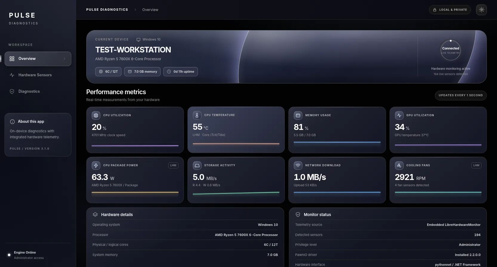
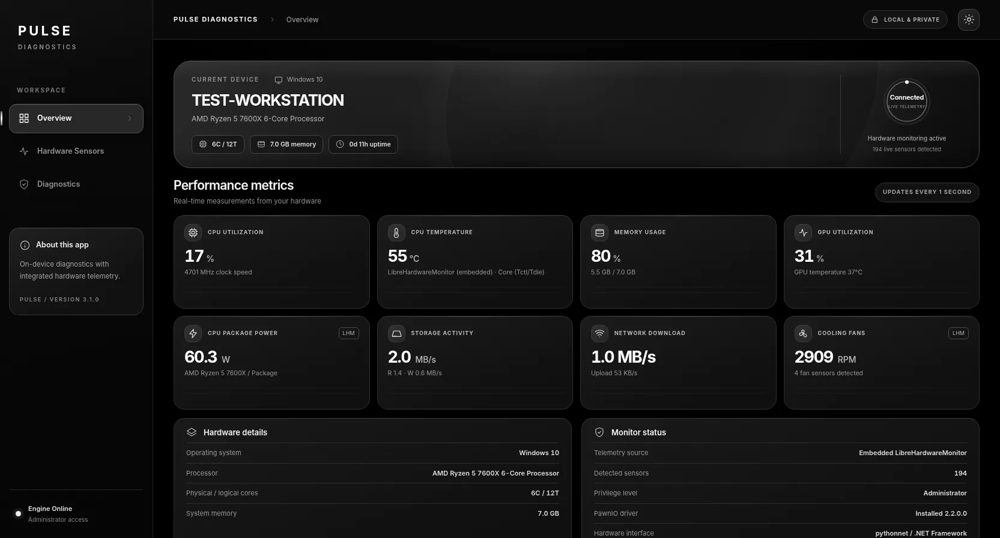
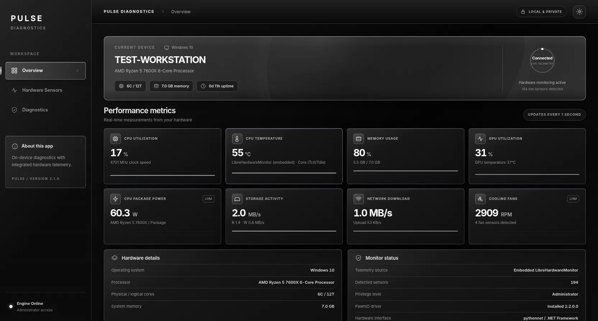
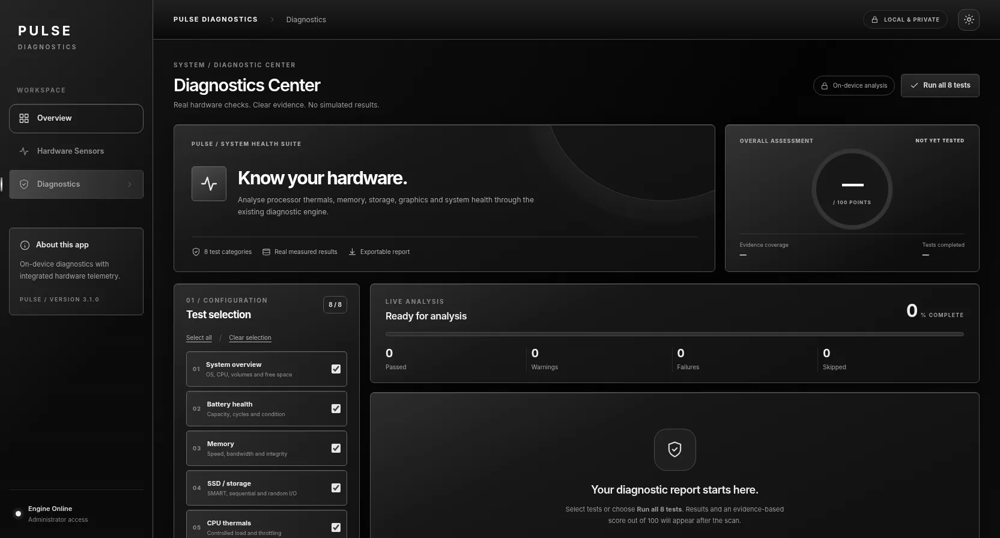
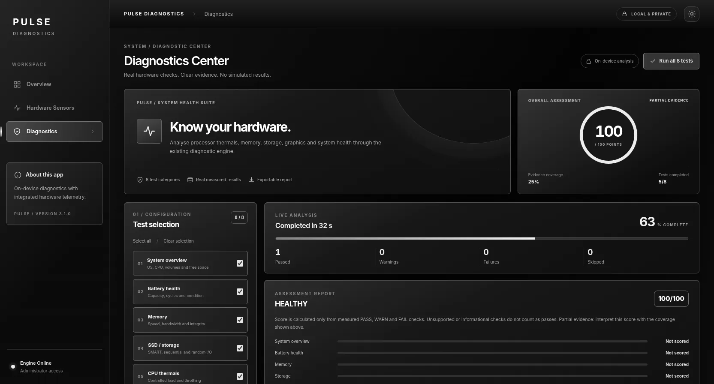

<div align="center">

# PULSE DIAGNOSTICS

### Know your hardware. Understand its performance.

A modern, local-first hardware monitoring and diagnostics application for Windows.
Explore real-time telemetry, inspect available hardware sensors, run guided system checks, and review evidence-based health assessments—all from one desktop dashboard.

**Windows 10 / 11** &nbsp;·&nbsp; **React Interface** &nbsp;·&nbsp; **Embedded Chromium** &nbsp;·&nbsp; **Local-First**

[Explore Features](#features) &nbsp;·&nbsp; [Build for Windows](#getting-started) &nbsp;·&nbsp; [Project Website](website/)

</div>

---

<p align="center">
  
</p>

<p align="center"><sub>Prism Glass interface · preview uses illustrative test data, not readings from your computer</sub></p>

## Overview

**Pulse Diagnostics** brings hardware monitoring and system health checks together in a purpose-built Windows app. It combines a responsive React frontend with a Python diagnostic engine and a Chromium renderer bundled through Qt WebEngine.

It is designed to show **what the hardware actually reports**. Unsupported sensors remain unavailable rather than being replaced by estimated or invented readings.

## Features

| | Capability | Details |
| :---: | --- | --- |
| 01 | **Live Performance** | CPU usage and temperature, memory, GPU activity, package power, storage throughput, network transfer and available fan speeds. |
| 02 | **Colored History Graphs** | Individual telemetry colors with continuously updating charts and selectable dashboard themes. |
| 03 | **Hardware Sensors** | Search and inspect sensor readings exposed by LibreHardwareMonitor, including the source and availability of measurements. |
| 04 | **Diagnostics Center** | Run checks covering CPU, memory, storage, graphics, networking, processes, system information and battery where supported. |
| 05 | **System Assessment** | A weighted score out of 100, with evidence coverage so unsupported or skipped checks are not silently counted as passes. |
| 06 | **System Optimizer** | Windows optimization actions with operation-specific results and permission checks. |
| 07 | **Local Reports** | Export diagnostic results and hardware-sensor data for review and troubleshooting. |

### Built around clarity

- **On-device operation:** telemetry and diagnostics run locally rather than through a remote monitoring service.
- **No WebView2 dependency:** Qt WebEngine provides the embedded Chromium renderer in packaged builds.
- **Hardware-aware measurements:** sensor visibility depends on device support, firmware, drivers and access permissions.
- **Multiple themes:** change the visual appearance without changing how hardware data is collected.

## Interface

<table>
  <tr>
    <td width="50%" align="center"><br /><strong>Pure Black</strong></td>
    <td width="50%" align="center"><br /><strong>Titanium</strong></td>
  </tr>
</table>

<p align="center"><sub>UI preview images use illustrative data.</sub></p>

### Diagnostics & assessment

<p align="center">
  
  
</p>

Diagnostics can be run individually or as a suite. Scores are based on available test evidence and should not be interpreted as a guarantee of hardware condition or reliability.

## Getting started

### Requirements

- Windows 10 or Windows 11, 64-bit
- 64-bit Python 3.11 or later, with `pip`
- .NET Framework 4.8 for the LibreHardwareMonitor sensor integration
- Internet connection for the initial dependency download and Windows build

### Build the desktop application

Clone the project, open its folder on Windows, and run:

```bat
build_release.bat
```

The generated application is written to:

```text
dist\PulseDiagnostics.exe
```

The release builder packages Qt WebEngine (Chromium) with the application. It also stages the monitoring dependencies required for a Windows build. The **optional PawnIO hardware-access driver is not installed automatically**.

For a console-enabled folder build, run `build_debug.bat`. More information: **[Building and troubleshooting](docs/BUILDING.md)**.

> This repository contains source code and the prebuilt offline React UI, not a precompiled Windows executable.

## Architecture

```text
React UI (frontend/ → ui/index.html)
            │
            ▼
  Qt WebEngine + WebChannel
            │
            ▼
     Python desktop API
      ├─ Live telemetry
      ├─ Hardware sensors (LibreHardwareMonitor)
      ├─ Diagnostics and assessment
      ├─ Optimization operations
      └─ Local report exports
```

| Component | Technology |
| --- | --- |
| Desktop interface | React 18 · HTML/CSS · Canvas graphs |
| Window and rendering | PySide6 · Qt WebEngine (Chromium) |
| UI/backend communication | Qt WebChannel |
| Diagnostics | Python · psutil · platform-specific checks |
| Sensor integration | LibreHardwareMonitorLib · pythonnet · optional PawnIO |
| Windows packaging | PyInstaller |
| Product website | Static HTML · CSS · JavaScript |

## Project structure

```text
PulseDiagnostics/
├── main.py                 # Startup entry point
├── chromium_shell.py       # Desktop window and WebChannel bridge
├── desktop_backend.py      # Telemetry and UI APIs
├── hardware_sensors.py     # Sensor integration
├── system_diagnostics.py   # Diagnostic engine
├── assessment.py           # Health assessment scoring
├── optimizer.py            # Optimization operations
├── frontend/               # Editable React frontend
├── ui/                     # Bundled offline desktop UI
├── website/                # Public-facing product website
├── assets/                 # Application assets
├── docs/                   # Technical guides
├── tests/                  # Automated tests
└── build_release.bat       # Windows release builder
```

## Documentation

- [Build and run the desktop app](docs/BUILDING.md)
- [Explore and deploy the website](website/README.md)
- [Third-party components and redistribution](docs/THIRD_PARTY.md)
- [Project changes](CHANGELOG.md)

## Development & testing

Frontend sources are in `frontend/`; the bundled UI is `ui/index.html`. To regenerate the offline frontend after making changes, run `python frontend/build.py` (Node.js/npm required).

Run the automated Python suite with:

```bash
python -m unittest discover -s tests -v
```

Tests use controlled fixtures where appropriate; hardware behavior and frozen Windows builds must also be validated on a supported Windows system.

## Privacy & hardware support

Pulse Diagnostics runs its desktop telemetry and reporting locally. Reports can include device names, hostnames and system configuration—review exported files before sharing them. Some readings require additional privileges or supported hardware drivers; missing values are reported as unavailable.

## License & third-party notices

A project-wide open-source license has **not** been assigned. Source availability alone does not grant redistribution or reuse rights. Integrated libraries and hardware drivers remain subject to their own licenses—see [third-party notices](docs/THIRD_PARTY.md).

---

<div align="center">

**PULSE DIAGNOSTICS**  
*Hardware insight, without the guesswork.*

</div>
